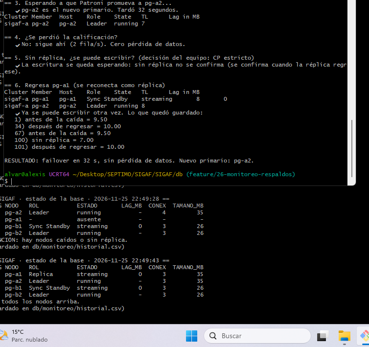
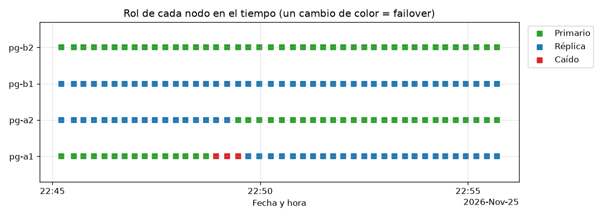
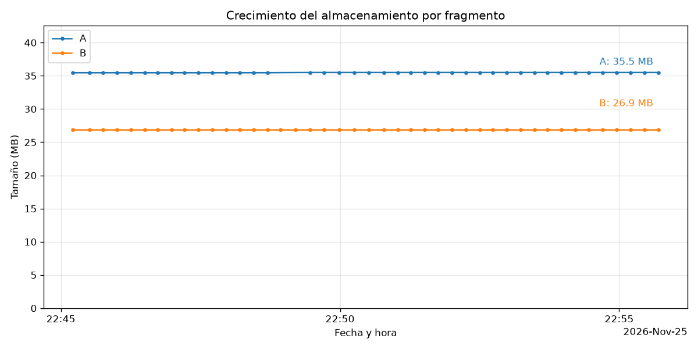
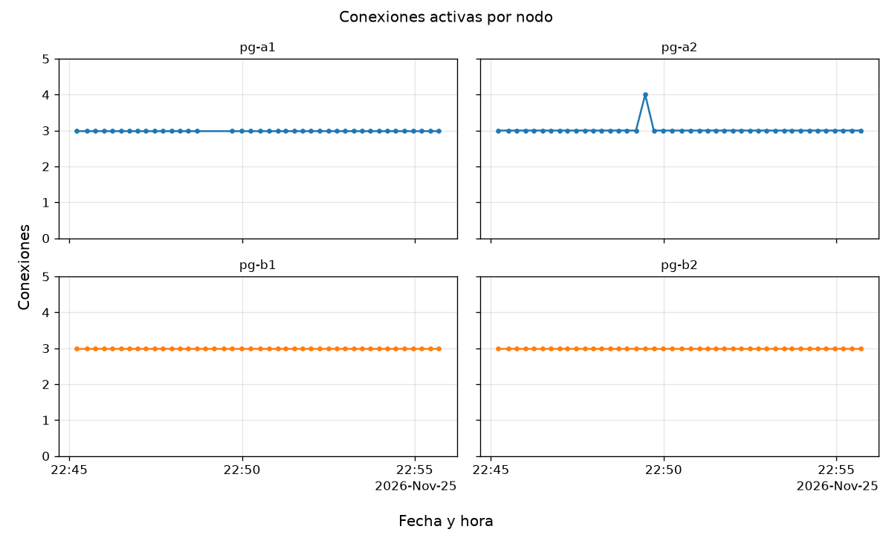
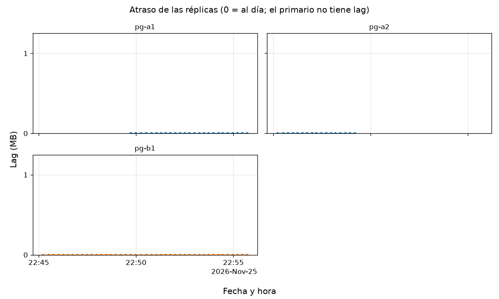
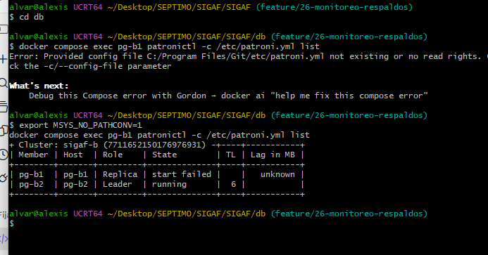
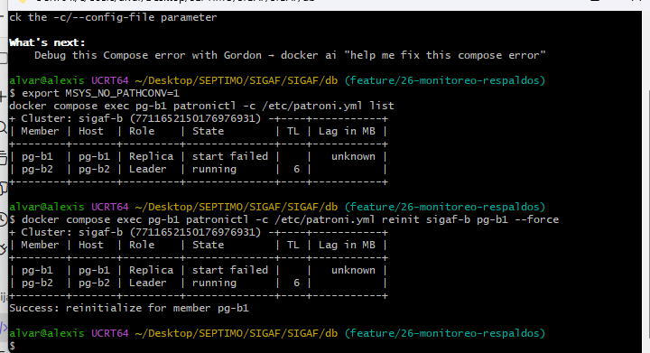
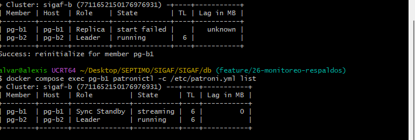
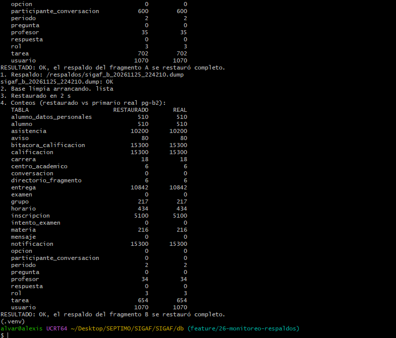

# Monitoreo y respaldos de la base distribuida (issue #26)

Cumple Lineamientos v5, IV.a.6: monitorear el estado de los nodos, las conexiones
activas y el crecimiento del almacenamiento, y tener un esquema de respaldo y
recuperación probado.

## Decisiones (las tomó alex el 25 nov 2026; la IA solo presentó alternativas)

| Tema | Elegido | Descartado y por qué |
|---|---|---|
| Monitoreo | Script `db/monitoreo/estado.sh` + historial CSV + gráficas con Matplotlib | Prometheus + Grafana: 3 contenedores más, más RAM y más TLS que configurar. Solo `patronictl`: no muestra conexiones ni almacenamiento. |
| Tipo de respaldo | `pg_dump` lógico por fragmento | `pg_basebackup`: restaurar es levantar un servidor completo. pgBackRest: otro programa que instalar, demasiado para el tamaño del proyecto. |
| Desde dónde | Contenedor `respaldos` que lee la **réplica** con **TLS** y un usuario de **solo lectura** | Script en Windows con el superusuario: depende de una PC y no respeta mínimo privilegio. |

Justificación propia: 
En monitoreo en esta desicion una de mis principales razones para escoger un script con un csv fue debido a la facilidad y el bajo consumo de resursos en el sistema, otra opcion fue llegar a usar prometheus pero el uso de la memoria ram era una prioridad debido a que este implicaba usar mas contenedores.
en el caso del tipo de respaldo se escogio el pg_dump es que este saca todos los datos de la estructura y los comprime y este es facil de restaurar en cualquier postgre, a diferncia del basepackup que ocupaba de levantar todo un servidor de nuevo 
en este ultimo caso se creo un usuario sigaf_respaldo el cual solo tiene permitido leer y este se conecta a usando tls debido a que asi las conexiones son cifradas de esta manera aseguramos que los certificados sean correctos
el respaldo sale de la replica para que a la hora de hacer  alguna consulta esta no se atore, la replica es sincrona al primario asi esta siempre tendra los mismos datos

## 1. Monitoreo

```bash
cd db
bash monitoreo/estado.sh          # una foto
bash monitoreo/estado.sh 60       # una foto cada 60 s (Ctrl+C para parar)
```

Por cada nodo muestra:

| Columna | De dónde sale | Qué significa |
|---|---|---|
| ROL / ESTADO | `patronictl list` | Leader = primario, Sync Standby = réplica síncrona. `no responde` = el contenedor no contesta SQL; `ausente` = Patroni ya lo sacó de la lista. |
| LAG_MB | `patronictl list` | Qué tan atrasada va la réplica (0 = al día). |
| CONEX | `pg_stat_activity` (`backend_type = 'client backend'`) | Conexiones de clientes. En reposo son 3: las de Patroni. |
| TAMANO_MB | `pg_database_size('postgres')` | Tamaño de la base en ese nodo. |

Si algo está mal imprime `ATENCIÓN` y termina con código 1 (sirve para
automatizarlo). Cada foto se agrega a `db/monitoreo/historial.csv` (no se sube
al repo). Además está el tablero de HAProxy en http://localhost:7000.

El script entra a cada contenedor como `postgres` por socket local
(`local all postgres peer`): es la excepción de "admin local" del equipo, nada
viaja por la red.

### Gráficas (Matplotlib)

```bash
cd db/monitoreo
pip install -r requirements.txt
python graficas.py                # deja 4 PNG en db/monitoreo/salida/
```

| Archivo | Qué muestra |
|---|---|
| `1_tamano_fragmentos.png` | Crecimiento de A y B en MB (medido en el primario; el eje empieza en 0 para no exagerar). |
| `2_conexiones_nodos.png` | Conexiones de cada nodo, una gráfica por nodo. |
| `3_roles_nodos.png` | Rol de cada nodo en el tiempo: verde primario, azul réplica, rojo caído. Un cambio de color es un failover. |
| `4_lag_replicas.png` | Atraso de las réplicas. |

Pruebas: `cd db/monitoreo && pip install -r requirements-dev.txt && pytest`
(14 pruebas, cobertura 97 %).

## 2. Respaldos

El servicio `respaldos` del compose arranca con todo lo demás:

- Cada 24 h hace `pg_dump -Fc` de A y de B (si falla, reintenta en 5 min).
- Lee de la **réplica** de cada fragmento para no cargar al primario; si no hay réplica, usa el primario.
- Se conecta con **TLS `verify-full`**: revisa que el certificado del nodo lo firmó la CA del proyecto y que es de ese nodo.
- Usuario **`sigaf_respaldo`**: solo `pg_read_all_data` y `default_transaction_read_only = on`. No puede escribir, crear ni replicar. Solo puede entrar desde la red de Docker/LAN y con TLS.
- Archivos en el volumen `respaldos`: `sigaf_a_AAAAMMDD_HHMMSS.dump` + su `.sha256`, con permisos 600. Guarda los últimos 7 de cada fragmento. Bitácora en `/respaldos/respaldos.log`.

```bash
cd db
docker compose exec respaldos respaldar.sh una        # respaldo ahora mismo
docker compose exec respaldos ls -l /respaldos        # ver los archivos
docker compose cp respaldos:/respaldos ./copia        # sacar una copia a tu PC
```

Variables opcionales en `.env`: `SIGAF_RESPALDO_INTERVALO` (segundos) y `SIGAF_RESPALDO_GUARDAR`.

**Base que ya existía:** el usuario lo crea `post_bootstrap.sh` solo en bases nuevas.
En una base que ya estaba arriba, agrega `SIGAF_PASS_RESPALDO` a `db/.env` y corre una vez:

```bash
docker compose up -d --build        # recrea los nodos con la regla nueva de pg_hba
bash respaldos/crear_usuario.sh
```

## 3. Prueba de recuperación

```bash
cd db
bash respaldos/probar_restauracion.sh      # fragmento A
bash respaldos/probar_restauracion.sh b    # fragmento B
```

1. Toma el respaldo más nuevo y revisa su sha256 (que el archivo no se dañó).
2. Levanta un PostgreSQL 16 limpio y desechable **sin red** (`--network none`): no puede tocar los nodos reales.
3. Restaura con `pg_restore --no-owner --no-privileges`.
4. Compara el conteo de filas de las 28 tablas de `sigaf` contra el primario real.
5. Borra el contenedor desechable.

## Evidencia (PC de alex, Windows + Docker Desktop, 25 nov 2026)

Base con los datos del reparto (#8): A ≈ 35 MB y B ≈ 26 MB.

### Monitoreo durante una caída

`bash monitoreo/estado.sh 10` en una ventana y `bash patroni/prueba_caida.sh` en otra:

```
== SIGAF · estado de la base · 2026-11-25 22:48:42 ==
A    pg-a1  Leader        running           -      3         35
A    pg-a2  Sync Standby  streaming         0      3         35
OK: todos los nodos arriba.

== 22:48:56 ==   (prueba_caida.sh tumba a pg-a1)
A    pg-a1  Leader        no responde       -      -          -
A    pg-a2  Sync Standby  streaming         0      3         35
ATENCIÓN: hay nodos caídos o sin réplica.

== 22:49:28 ==   (Patroni ya promovió a pg-a2)
A    pg-a2  Leader        running           -      4         35
A    pg-a1  -             ausente           -      -          -
ATENCIÓN: hay nodos caídos o sin réplica.

== 22:49:43 ==   (pg-a1 regresa como réplica)
A    pg-a1  Replica       streaming         0      3         35
A    pg-a2  Leader        running           -      3         35
OK: todos los nodos arriba.
```

`prueba_caida.sh`: nuevo primario en 32 s, cero pérdida de datos y, sin réplica, la
escritura se queda esperando (CP estricto).



### Gráficas (Matplotlib, 173 mediciones en 10 minutos)

En la gráfica de roles se ve el failover: pg-a1 pasa de verde (primario) a rojo
(caído) y regresa azul (réplica), mientras pg-a2 pasa de azul a verde.






Pruebas: `14 passed`, cobertura 97 % (`pytest -q` en `db/monitoreo`).

### Una falla real que detectamos: réplica de B en "start failed"

Al recrear los contenedores con `docker compose up -d --build`, la réplica `pg-b1`
no arrancó. Por el CP estricto, el primario `pg-b2` no aceptó escrituras (crear
`sigaf_respaldo` se quedó esperando) hasta reconstruir la réplica con
`patronictl reinit sigaf-b pg-b1 --force`. Después quedó `Sync Standby | streaming | 0`
y la escritura pendiente terminó sola.





### Respaldo

```
2026-11-25 22:42:10 OK fragmento A desde pg-a2 -> sigaf_a_20261125_224208.dump (888K)
2026-11-25 22:42:10 OK fragmento B desde pg-b1 -> sigaf_b_20261125_224210.dump (888K)
```

Los dos salieron de la **réplica** de cada fragmento.

### Restauración

```
1. Respaldo: /respaldos/sigaf_a_20261125_224208.dump
sigaf_a_20261125_224208.dump: OK
3. Restaurado en 1 s
4. Conteos (restaurado vs primario real pg-a1):
   alumno                              490        490
   calificacion                      14700      14700
   entrega                           10486      10486
   inscripcion                        4900       4900
   usuario                            1070       1070
   ... (28 tablas, todas iguales)
RESULTADO: OK, el respaldo del fragmento A se restauró completo.
```

Fragmento B: también OK (510 alumnos, 15 300 calificaciones, 10 842 entregas).



### TLS y solo lectura (prueba en la nube, misma configuración)

```
pg_stat_ssl               -> ssl = t, TLSv1.3
DELETE FROM sigaf.alumno  -> ERROR: cannot execute DELETE in a read-only transaction
sin TLS                   -> FATAL: pg_hba.conf rejects connection ... no encryption
por haproxy (verify-full) -> server certificate for "pg-a2" does not match host name "haproxy"
rotación con GUARDAR=2    -> borrado por rotación: sigaf_a_..._202656.dump
```

## Límites conocidos

- Los respaldos viven en la misma PC que la base. Si se pierde la PC, se pierden. Falta copiarlos a otra laptop o USB (`docker compose cp`), sobre todo cuando exista el nodo remoto.
- `pg_dump` es una foto: lo escrito después del último respaldo se pierde (hasta 24 h). Para volver a un minuto exacto haría falta archivado de WAL (pgBackRest).
- Los `.dump` traen datos de alumnos (los nombres van cifrados con AES y las matrículas con HMAC). No se suben al repo.
- Tras recrear los contenedores, una réplica puede quedar en `start failed` (nos pasó con pg-b1). `estado.sh` lo marca; se arregla con `patronictl reinit`.
- El volumen `certs` también trae `ca.key`; el contenedor de respaldos solo usa `ca.crt`, pero lo ve montado.
